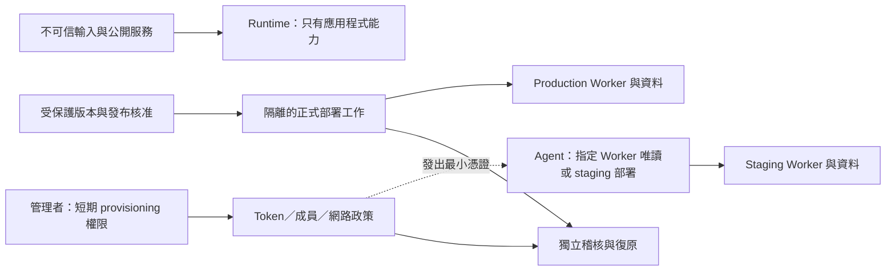

# Cloudflare 控制平面強化基準

最後研究：2026-10-25。這是可執行的目標基準，不是已套用聲明，也不是保證供應商不遭入侵。先盤點，再針對有證據的風險實施；不把強化需求變成重建全部系統。事件背景見 [Zeabur 來源筆記](zeabur-lessons.md)。

## 我們要切斷的路徑

我們從事件中要防止的是：公開工作負載遭入侵 → 取得管理憑證 → 擴大到其他環境／資源 → 讀取 secrets／資料 → 撤銷不完整而重返。Cloudflare 代管 Workers 不需要由客戶管理 Zeabur 那種共用 Kubernetes 控制面，但客戶自己的 Token、CI、維運工具、帳戶成員與第三方供應鏈仍形成權力通道。

部署權本身是敏感權力：能換上任意程式的人，可能透過程式讀取該 Worker 的 runtime secrets 及 bindings。Secrets UI 不顯示值，或把值放進 Secrets Store，都不能阻止有部署權的惡意程式使用已授予它的能力。這是從 Worker 執行模型導出的信任邊界，不是宣稱可繞過 Cloudflare 授權。[Workers secrets](https://developers.cloudflare.com/workers/configuration/secrets/) · [Bindings](https://developers.cloudflare.com/workers/runtime-apis/bindings/)

箭頭表示授權的用途，不是 Cloudflare 自動配置好的架構。核心可驗證條件：R 沒有控制平面 Token；A 沒有 production 寫入能力；C 只吃受控產物／版本；稽核及復原的管理權與部署權分開。若同帳戶 resource scope 不能滿足要求，我們再考慮分帳戶；不以專案命名或「內網」推定隔離。

## 控制、配置方式與驗收

| 優先 | 控制及原因 | Agent 配置路徑與身分 | 驗收／限制與回復 |
| --- | --- | --- | --- |
| 基礎 | 人員登入強化；移除閒置成員與不必要 Super Admin | 管理者核對成員政策；開啟帳戶 2FA Enforcement，管理者使用防釣魚安全金鑰並保存復原方式。符合方案時評估 dashboard SSO／IdP MFA | 先確認另一個可用復原管理路徑，再測授權成員登入；SSO、個人 2FA 和 bearer API Token 是不同控制。回復靠獨立管理者，不依賴正被修改的登入路徑 |
| 基礎 | 依環境、用途、來源分割 Token | 指定 Worker 的 Metadata／Content／Editor；短期管理身分查詢 permission groups 和 Token policy，產出新 Token 配置；機器作業優先 account-owned，產品不支援時明列替代方案 | 從實際 consumer 讀取指定目標；其他環境的政策範圍不含寫入。既有 Token 遷移完成後撤銷；角色不支援真正 deploy-only 時如實說明 |
| 基礎 | Runtime 與管理面分離，避免一次入侵取得管理能力 | 檢查 Worker vars／secrets 名稱、CI、建置快取與維運程式；Cloudflare 管理／provisioning Token 留在外部受控管理工作，不綁到公開 Worker | 以合成憑證測 log／artifact 遮蔽；核對執行環境注入白名單，不為盤查讀出真實 secret；已外洩值必須撤銷，刪檔不算處理完成 |
| 基礎 | PR／不可信 build 不取得 production 部署秘密 | 在 Git provider 保護 branch、release、workflow 與環境；部署憑證由隔離且受控的 job 使用，不傳給不可信 PR、依賴安裝腳本或互動 agent | 檢查 build 與 deploy 是否同一執行環境可讀 Token；僅分兩個 steps 不等於程序隔離。驗證無權修改發版規則的 actor 無法取得 production secret；不假設有原生 OIDC，需查產品支援 |
| 基礎 | Staging 資料、認證與正式環境隔離 | 比對實際 binding IDs、外部服務 sandbox、service bindings、資料讀取權限；同帳戶／分帳戶根據敏感度選擇 | 目前不同 namespace 是現況證據，不等於部署者永遠無法改綁。要強邊界時用不同帳戶和分開消費者憑證，再驗跨帳戶路徑 |
| 輔助 | Token TTL 與來源限制 | 管理身分用 [automation.md](automation.md) 批次更新完整 CIDR；OpenAI、CI、本機分開來源策略；TTL 符合任務／維護週期 | 同 CIDR 中的其他持有者仍可使用外洩 Token；不可信程式在允許的 runner 上也可濫用它。若 API 不能容納完整清單，改固定受控出口，不放寬成 /0 |
| 基礎 | 控制平面稽核可查且可留存 | 唯讀稽核身分查 Audit Logs v2；log pipeline 管理者依方案配置 Logpush，或由外部唯讀工作增量匯出；獨立儲存目的地 | 測一筆已授權的合成變更／讀取事件能關聯 actor、Token、資源與時間；記錄延遲／排除端點／留存。日誌中不出現不代表未發生；告警是外部規則／SIEM 工作，不假稱 API 自動已有 |
| 基礎 | 完整撤銷與復原 | 憑證清冊包含 active、舊版、consumer、到期、backup、CI cache；事件時由獨立管理身分撤銷可疑 Token／session，替換下游可讀 secrets，查部署與路由 | 一般輪替可先切換再撤銷；已確認洩漏要先限制／撤銷並處理中斷，不為保持可用性讓攻擊者繼續用。還原演練在專用資料，先評估 DO／DB migration 相容性 |
| 按需 | 內部管理入口身分驗證 | 對自建管理服務配置 Access／每服務的 Service Auth、來源與應用程式本身授權；service token 最小 audience／期限 | 防止直接 origin 繞過，驗證拒絕路徑；Access service token 是另一種秘密。應用程式 Access／WAF 不會保護 `api.cloudflare.com`；Cloudflare API 用 Token policy 管理 |

人員設定依 [2FA 官方指南](https://developers.cloudflare.com/learning-paths/application-security/account-security/set-up-2fa/) 與 [Dashboard SSO](https://developers.cloudflare.com/fundamentals/manage-members/dashboard-sso/) 當場確認方案與帳戶設定。帳戶 Token 的建立需要相應 provisioning 權限，普通工作用 Token 不授予這種權力。[Account-owned Tokens](https://developers.cloudflare.com/fundamentals/api/get-started/account-owned-tokens/)

## 稽核不是只看紅燈

至少建立以下監測意圖，使用當前實際 audit schema／可用事件，而不是猜 event name：

- Token 建立、擴大 scope、關閉 IP 條件、延長 TTL、重新啟用與異常來源使用。
- 成員／角色／SSO／Access policy 變更、未知 session 或 break-glass 使用。
- 不預期的 Worker 部署、secret／binding／route／DNS 變更，並關聯批准版本。
- 超出工作需要的資料資源讀取與匯出；其可觀測性可能需要產品資料面日誌，帳戶 Audit Logs 不等於所有 Worker 對 KV／R2／DO 的資料操作紀錄。
- 稽核匯出停止、落後與設定被改動；驗收包含通知實際收到與保留目的地權限，而非只有 job 存在。

Audit Logs v2 當前官方說明會記錄支援端點的 view，Dashboard 預設把 view 隱藏，API／Logpush 不受此 UI filter 影響；仍有排除端點。留存、Enterprise Logpush 與其他方案替代路徑以當前帳戶及 [Audit Logs 文件](https://developers.cloudflare.com/fundamentals/account/account-security/audit-logs/) 查證。Logpush 管理可能連查看 job 都需要 Edit，不把這權限混進一般觀察 Token。[Logpush 權限](https://developers.cloudflare.com/logs/logpush/permissions/)

## 基線與強隔離的選擇

我們可先用指定 Worker scope、分開 CI 憑證、TTL／來源、獨立稽核與完整輪替形成基線。它不新增常駐服務，遷移也能逐 consumer 進行，適合先縮小單一外洩 Token 的影響。但仍信任同帳戶部署者、發布 runner 和帳戶管理者；對 production runtime secrets 有保密要求時，Editor 不能交給不可信 actor。

更強選項是分開 staging／production 帳戶、受控正式發版、必要時固定出口／執行 relay。好處是把帳戶資源與管理身分再切一層；代價是跨帳戶網域、服務、資料搬遷與費用／復原路徑較複雜，仍不能阻止 production 發布身分遭入侵。這是需要獨立評估的遷移，不會因啟用此 skill 就自動搬遷或部署新服務。

| 比較 | 指定資源與憑證分割基線 | 分帳戶與受控正式發布 |
| --- | --- | --- |
| 安全效果 | 縮小指定 Token 權限與壽命；同帳戶管理風險仍在 | 降低測試身分接觸正式資源的機會；仍信任正式發布與帳戶管理者 |
| 延遲／資源 | 政策不在每次應用請求新增服務；批次更新為離線工作 | 跨帳戶／relay 若在路徑中可能新增延遲與成本，須測實際路徑 |
| 可用性 | feed 變動或 TTL 到期可能中斷；保留可回復管理路徑 | 多帳戶、DNS、產物升版與復原協調成本增加 |
| 遷移／可逆性 | 逐 consumer 換 Token；可回復原政策但不恢復已洩漏 Token | 先測試新帳戶；資料雙寫／遷移需專案方案，不能承諾一鍵回滾 |
| 驗證 | 指定資源成功、其他資源不含權限、事件與輪替證據 | 加上跨帳戶拒絕、正式版本來源、資料／服務依賴及復原演練 |

上表是基於文件的設計推論，未量測效能，也未在使用者帳戶套用。我建議先建立可觀測基線，再針對不可信 agent、敏感資料或多租戶需求選擇強隔離。兩者都無法承諾供應商內部控制平面完全不被攻破；必要的資料最小化、外部金鑰及復原設計仍需保留。
